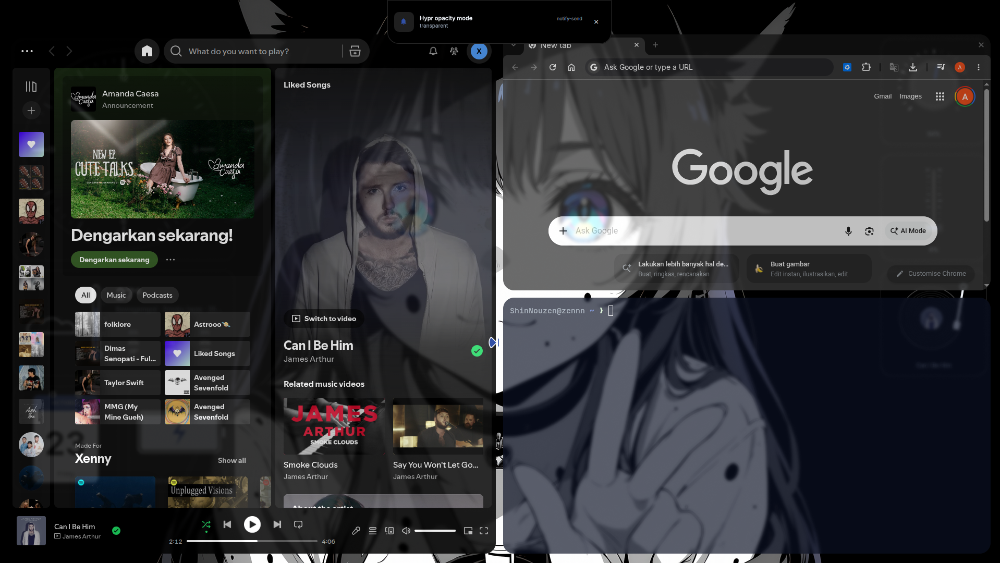
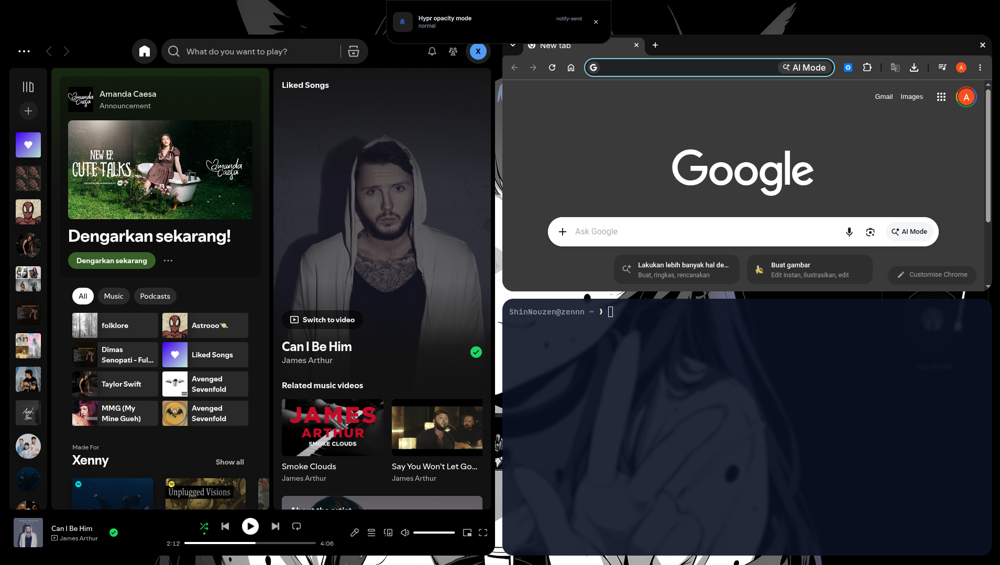

<div align="center">

# hypr-opacity

A small Hyprland utility for instant window opacity switching.

Normal mode. Transparent mode. One keybind.

<br>




<br>

[](https://hyprland.org/)
[](https://pubs.opengroup.org/onlinepubs/9699919799/)

</div>

## What it does

Toggle opacity without restarting Hyprland or reloading your config.

| Mode | Active | Inactive |
|---|---:|---:|
| Normal | `1.00` | `1.00` |
| Transparent | `0.85` | `0.75` |

Transparent mode keeps windows readable while showing more of your wallpaper and desktop.

## Requirements

- Hyprland `0.56+`
- `hyprctl`
- POSIX-compatible shell
- `notify-send` optional, used for notifications

## Install

Clone the repository, then run the installer:

```sh
git clone https://github.com/Zennn01/hypr-opacity.git
cd hypr-opacity
./install.sh
```

Installer copies the command to:

```text
~/.local/bin/hypr-opacity-mode
```

Existing files receive a timestamped backup before replacement.

## Usage

```sh
hypr-opacity-mode toggle
hypr-opacity-mode transparent
hypr-opacity-mode normal
```

State is stored at:

```text
~/.local/state/hypr-opacity-mode
```

Runtime changes use `hyprctl eval`, so no config reload is needed.

## Keybind

Add this to your Hyprland Lua keybind module:

```lua
hl.bind(
    "SUPER + O",
    hl.dsp.exec_cmd("/home/YOUR_USERNAME/.local/bin/hypr-opacity-mode toggle")
)
```

Replace `YOUR_USERNAME` with your Linux username.

## Tuning

Edit `hypr-opacity-mode` before running `./install.sh`, or edit the installed copy directly.

```sh
active_opacity = 0.85
inactive_opacity = 0.75
```

Higher values mean more opaque. `1.0` means fully opaque.

## Uninstall

```sh
./uninstall.sh
```

This removes the installed command. State files and backups remain untouched.

## Files

```text
hypr-opacity-mode  Runtime toggle command
install.sh         Installer with backup support
uninstall.sh       Removes installed command
assets/            Screenshots
```

## License

Use, modify, and share freely.
